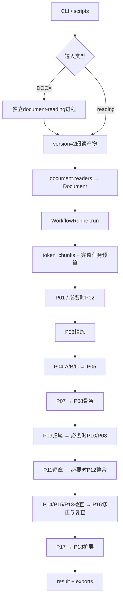

# 代码导引：模块、文件与运行流转

核对日期：2026-11-08；代码版本：0.11.0。本文描述当前代码，不把历史设计计划当作已实现。环境、业务规则、已知故障及实验结论统一见[项目公共文件](../PROJECT_CONTEXT.md)。

## 1. 先看哪里

理解一次运行的最短路径：

1. `src/bid_outline/cli.py::execute`：参数、输入、provider和run生命周期。
2. `domain/__init__.py`：正文、来源、要求、目录、归属、检查的对象契约。
3. `document/readers.py::read_document`：上游阅读产物如何进入本项目。
4. `workflow/runner.py::run`：完整阶段顺序，再按需要读对应方法。
5. `model/executor.py::_execute`：每次调用的预算、审计、重试与采用。
6. `workflow/outline.py`与`storage/repository.py`：候选如何变为正式目录版本。
7. `export/markdown.py::export_result`：输出来自哪些已采用数据。

下表和后文以`src/bid_outline/`为源码路径基准；脚本、配置和测试路径相对项目根目录。

## 2. 仓库边界

| 目录/文件 | 负责内容 | 不应混淆的边界 |
|---|---|---|
| `src/bid_outline/` | 本项目生成工作流 | 不负责DOCX原始解析 |
| `document-reading/` | 已有Docling＋OOXML阅读副本与独立运行时 | 按接口接入；标题识别不是技术标目录生成 |
| `configs/` | 示例运行配置 | 服务能力声明与代码默认值分开看 |
| `scripts/` | 单文件GPU测试、四文件train批处理和计时 | 编排多个进程，不替代业务runner |
| `tests/unit/`、`tests/integration/` | 机械契约、失败恢复、模拟全流程回归 | 不等于真实模型语义验收 |
| `test_inputs/`、`test_materials/` | 实际输入及历史样例 | 样例适配器不是生产阅读器 |
| `runs/`、`logs/` | 每次真实运行、日志、导出、审计 | 不作为源码或默认配置编辑 |
| `reviews/` | 审查、对照脚本、冻结样例、诊断报告 | 历史结果不可当作现版本必然表现 |
| `docs/` | 业务基线和逐版本实现记录 | 01–06含早期设计，07以后多为历史阶段记录 |
| `pyproject.toml` | 包版本、依赖、CLI入口、pytest配置 | 真实tokenizer依赖另列可选extra |
| `environment-cu128.yml`、`requirements-cu128.txt` | 已有环境记录 | 不要求每次重新安装环境 |

`__pycache__/`和运行生成文件不属于需要人工维护的功能模块。

## 3. 源码文件职责

### 3.1 入口、配置与数据模型

| 文件 | 主要职责 |
|---|---|
| `__init__.py` | 应用版本；恢复时与旧run版本比较 |
| `__main__.py` | `python -m bid_outline`入口，转交CLI |
| `cli.py` | `run/resume/export/status/doctor`命令，run锁、配置加载、阅读桥接、provider选择、runner创建与资源关闭；导出/状态读取不生成模型内容 |
| `config.py` | `AppConfig`严格参数校验；预算、并发、重试、train参数、thinking逐任务优先级及协议选择；`load_config`支持配置快照布局 |
| `domain/__init__.py` | Pydantic领域对象与目录树校验；禁止重复节点、丢失父节点、循环、非法层级/顺序等 |

核心对象：

| 对象 | 主要数据及用途 |
|---|---|
| `SourceRef` | document/element/table/cell身份、文本范围、精度与reader元信息；不推断不存在的页码或字符对齐 |
| `DocumentElement`、`Document` | 适配后的原文元素、顺序、章节路径、表格元数据、输入哈希和诊断 |
| `Chunk` | 本次负责正文、独占来源、辅助上下文、跨小节`section_spans`、延续关系 |
| `RequirementGroup` | A/B/C或待定、主题、完整要求、材料引用与生产任务 |
| `OutlineNode`、`OutlineVersion` | 树节点、依据、来源，以及不可变目录快照和父版本 |
| `OutlineConstraint` | 保护节点、封闭子项、来源清单身份与相对顺序等 |
| `RequirementAssignment` | 要求到节点的承接范围、共同条件、未承接内容及所依赖目录版本 |
| `ReviewFinding`、`ExtensionSuggestion` | 检查发现及其状态、独立扩展建议及审核状态 |

### 3.2 阅读适配与分块：`document/`

| 文件 | 主要函数/职责 |
|---|---|
| `__init__.py` | 对外导出阅读、切块、拆块、查找接口 |
| `readers.py` | `read_document`接收reading目录或JSON，要求version=2和corrected；读取fragments/sections、原始表格及source_map/validation/manifest；`table_rows`恢复行与跨行父项；`_sample`提供显式历史样例适配 |
| `token_chunks.py` | `token_chunks`优先整章，再递归小节/语义单元；先扣提示和上下文额度，再用完整请求复核；生成稳定块身份和跨小节对应关系 |
| `chunks.py` | `chunk_document`旧字符打包兼容；`split_chunk`按已负责范围细分；`_table_parts`保留行组/表头/跨行条件；`_slice_ref`维护来源偏移 |
| `paragraph_context.py` | 列表组与范围保护，提取相邻引导句和条件作为辅助上下文；辅助内容不变成正文归属 |
| `lookup.py` | 关键词命中、引用候选定位、章节/附件/局部范围选择及查找线索；返回候选和范围证据，不由词命中直接确认业务关联 |

生产token路径通过runner提供的`source_allowance/source_fits`计算实际任务预算。字符路径保留给无tokenizer的离线模拟。单元不可安全拆分时保留失败范围，不截断正文来伪装成功。

### 3.3 业务流程：`workflow/`

| 文件 | 主要职责 |
|---|---|
| `__init__.py` | 包级runner入口 |
| `runner.py` | 主编排、任务材料准备、补读、阶段状态、要求/材料/归属集合、检查修正、版本集中提交；不直接HTTP请求 |
| `common.py` | `dump/present`构造类型化可读材料，稳定identity、ID列表、旧字符分批、`bounded_map`有界并发 |
| `context.py` | 背景候选、章节约束、祖先路径、章节候选局部编号隔离；候选不自动成为新增义务 |
| `history_view.py` | `HistoryPresenter`恢复前序调用短编号的原始语境，给当前输入附对应表；不篡改历史自由文本 |
| `outline.py` | 节点记录转领域对象，树关系与深度计算，版本建立、分支替换、保留骨架、封闭清单和保护约束执行 |
| `source_lists.py` | 将模型识别的清单绑定到具体来源材料和有界清单身份；保留原顺序/层级，拒绝跨材料错误拼接 |
| `repair_scope.py` | `RepairScope`冻结修正范围、要求、归属与约束；超预算可安全下分；`repair_waves`识别冲突并安排独立请求批次 |

`runner.py`方法导航：

| 方法 | 功能与后继 |
|---|---|
| `run` | 恢复校验/读取文档 → 分块 → 扫描与提取 → 分类 → 骨架及目录 → 复查修正 → 扩展 → result/manifest |
| `budget_messages/check_budget/fits` | 与执行器一致地准备短编号、协议和thinking计数，供规划阶段使用 |
| `source_messages/source_allowance/source_fits` | P01/P02/P03空正文开销预扣和完整块准入，P03预留初筛结果空间 |
| `process_chunk` | 捕获预算/截断，拆负责范围，移除被替代块的派生结果并递归处理 |
| `_process_chunk` | P01/P02判断 → P03精炼 → 精炼材料落盘 → P04-A/B/C分别提取 |
| `resolve_categories` | P05处理待定要求，保留无法消歧的事项 |
| `call` | 生成业务task_id、依赖和来源位置 → executor → 必要时P06确认引用并补读、有限重做 |
| `sources/requirement_inputs/scoped_ids` | 为同一范围组织资料、显式产物依赖和可引用身份 |
| `build_skeleton/skeleton_material` | P07结构依据 → P08建立或增补；完整预算分批、背景分页、来源清单与禁止新增约束绑定 |
| `assign_all/resolve_unassigned` | P09归属 → P10未承接调整建议 → 集中P08修改 → 重新归属 |
| `generate/branch_requirements` | 按章取得要求及分工，P11生成完整下级；多候选P12整合；集中提交各独立分支 |
| `review` | P14覆盖、P15结构、P13跨章交叉等发现汇总 |
| `review_and_repair` | 冻结检查范围 → P16局部修正 → 准入检查与版本提交 → 归属更新/复查；循环次数有限 |
| `extend` | P17给出独立建议 → P18检查其边界、条件和适用性 |
| `commit/refresh_assignments` | 执行约束、保存来源、事务更新目录版本；旧归属受修改影响时标待确认 |
| `result/aclose` | 汇总输出对象、取消/关闭执行器并刷新审计资源 |

### 3.4 模型执行与协议：`model/`

| 文件 | 主要职责 |
|---|---|
| `__init__.py` | 模型包入口 |
| `executor.py` | 唯一生成调用网关：task锁、指纹、缓存采用、预算、全局在途信号量、失败/格式重试、原始证据、task采用与恢复 |
| `client.py` | `ModelResponse/ModelClientError`、OpenAI HTTP客户端、FakeModelClient、provider工厂；真实工厂要求本地tokenizer及合法窗口配置 |
| `train_client.py` | 文本train query拼接、提交票据、轮询、终态ID匹配、thinking正文分离与原始响应保留；不确定提交不自动重提 |
| `budget.py` | `TokenBudget`本地fast tokenizer、计数缓存、任务开关模板、提示开销预扣、有效窗口及完整输入＋输出＋安全余量检查 |
| `packing.py` | `pack_items`按完整请求fits函数贪心组织完整记录；超大的单条交上层明确处理 |
| `task_specs.py` | P任务名称、模板和解析版本、模板读取、输入边界、短ID说明、strict/compact/Markdown提示选择 |
| `references.py` | 类型化引用契约、`Presented`、可见对象分组、短编号映射、输入视图渲染与输出引用恢复；自由文本不做全局替换 |
| `parsers.py` | strict字段/记录/枚举解析、ID角色检查、目录协议校验、格式反馈、有限且确定的闭合修复 |
| `compact_protocol.py` | 支持任务的简洁字段/记录格式，确定性补内部局部编号和标记，再交strict校验 |
| `markdown_directory.py` | P08/P11/P12/P16标题AST解析，生成节点/父子/顺序，按精确标题＋父节点恢复已有身份，再交strict校验；新标题仍要求依据 |
| `audit_io.py` | 异步调用串行I/O worker写证据，避免文件fsync阻塞事件循环；退出时drain |
| `call_view.py` | 按任务/触发阶段组织调用目录，生成`calls.md`和每次调用`summary.md`导航 |
| `replay.py` | 显式跨run精确请求复用，核对服务和请求内容；保留旧响应来源与哈希；train CLI禁止此模式 |

修改输出协议时须同时查看`task_specs → protocol adapter → parsers → references → workflow`，不能只放宽解析器而不检查领域约束。

### 3.5 提示文件：`model/prompts/`

每个`Pxx_任务名.txt`对应下表任务；P04有三个实际调用。模型每次独立执行，不承接隐含对话状态。

| 编号 | 文件任务名/职责 | staged_markdown配置中的thinking | 输出协议 |
|---|---|---|---|
| P01 | 整块相关性判断 | 关 | compact |
| P02 | 关键词命中复核 | 关 | compact |
| P03 | 相关内容保真摘取 | 关 | compact |
| P04-A | 格式与集中编制要求提取 | 关 | compact |
| P04-B | 技术评审要求提取 | 关 | compact |
| P04-C | 其他明确编制义务提取 | 关 | compact |
| P05 | 类别待定要求处理 | 关 | compact |
| P06 | 补读候选关联确认 | 关，即使由目录任务触发 | strict |
| P07 | 结构依据识别 | 开 | strict |
| P08 | 建立或增补骨架 | 开 | Markdown |
| P09 | 要求归属 | 开 | compact |
| P10 | 未承接要求与骨架调整 | 开 | strict |
| P11 | 逐章生成子目录 | 开 | Markdown |
| P12 | 超长章节候选整合 | 开 | Markdown |
| P13 | 跨章交叉与重复判断 | 开 | strict |
| P14 | 已提取要求覆盖检查 | 开 | compact |
| P15 | 目录语义结构检查 | 开 | strict |
| P16 | 指定范围局部修正 | 开 | Markdown |
| P17 | 项目化扩展建议 | 开 | strict |
| P18 | 扩展建议边界检查 | 开 | compact |
| P19 | 完整文本格式修复 | 默认关 | 保留模板/任务名；当前执行器的普通格式重试不是独立P19调用 |

以上仅描述该实验配置，不能当成所有配置的默认开关。

公共文件职责：`S00_公共系统规则.txt`由`render_task`每次作为system消息读取；
`ABC_提取共用规则.txt`、`B01_目录编排业务规则.txt`、`目录节点记录格式.txt`、`补读请求记录格式.txt`是共用规则/格式资料。当前任务txt已展开相关规则，运行时并不会递归替换所有common文件占位符；修改这些资料不等于所有P模板自动更新。参见[prompts说明](../src/bid_outline/model/prompts/README.md)。

### 3.6 存储与导出

| 文件 | 主要职责 |
|---|---|
| `storage/__init__.py` | 暴露ArtifactStore和RunRepository等接口 |
| `storage/artifact_store.py` | 规范JSON＋SHA256形成`a-*.json`；原子、非覆盖发布；envelope保存kind/data/parents/task_id；读取校验哈希 |
| `storage/repository.py` | SQLite保存run/tasks/attempts/outlines/head；任务采用指针、版本历史及expected_parent事务比较；共享文件系统使用DELETE journal而非WAL |
| `export/__init__.py` | 导出包接口 |
| `export/markdown.py` | `export_result`从结果对象生成四个导出文件；`write_atomic`供导航等可再生成文件原子更新 |

源码包内其余`__init__.py`承担接口导出，不另起独立业务流程。

## 4. 一次实际运行如何流转



1. `scripts/run_train_batch.py`找到四份DOCX，每份先启动独立阅读子进程，再启动生成CLI。`parallel-files`限制文件并发，`concurrency`传给每文件生成及阅读worker；两层并发相乘可能同时产生更多服务作业。
2. `cli.execute`持有run锁。新运行加载配置、阅读适配；恢复从SQLite读取旧配置/状态，再由runner核对版本和配置。
3. `WorkflowRunner.run`保存原始Document产物和manifest，规划源块，发起有限并发处理。没有要求或没有采用骨架时，后续目录步骤不会凭空启动。
4. 业务任务经`call`构造显式材料、范围、可见ID、父产物依赖，再交执行器；补读是有界分支，不是模型自由读取整个仓库。
5. 独立语义请求可并行；生成/修正结果返回后才由`commit`验证并集中修改目录。不得从多个协程各自直接覆盖head。
6. 结果status取决于未处理范围、问题与目录情况；CLI最终导出并关闭执行器。`semantic_quality=not_evaluated`不随格式或单元测试通过而变更。

## 5. 一次模型调用如何流转

```text
runner.call(task, material, allowed, dependencies)
  → prepare_inputs：冻结material_view/context_view，限定可见引用
  → executor.execute：task锁；任务采用/恢复入口
  → prepare_call_inputs：生成本次短编号
  → render_task：任务提示＋system＋本次资料＋选定输出协议
  → fingerprint：输入、依赖、配置、模板/解析/执行版本
  → 已有同指纹采用结果？返回；未采用旧响应？重解析恢复
  → TokenBudget.check：完整请求含thinking模板/生成额度/安全余量
  → 写请求与审计，在途信号量内调用provider
      OpenAI：POST chat/completions → ModelResponse
      train：提交query → 保存ticket → 同ticket轮询 → ModelResponse
  → 保存raw/model/output，再解析协议、校验引用
  → 有界格式重试或明确失败
  → 保存model_result产物 → SQLite commit_task采用
  → 返回runner；必要时P06补读，再按完整新输入生成新任务身份
```

关键区别：

- `request.json`是执行器语义请求，`request.http.json`是实际provider载荷；train是单query扁平化，不等同于原生system/user隔离。
- 预算拒绝可以发生在网络请求之前，此时可能只有task失败及`blocked_request_budget`产物，没有一次真实调用目录。
- 格式重试会追加错误反馈并重新计量；不能沿用首轮预算。
- train轮询期间仍占全局信号量；不是只限制提交瞬间。
- 提交结果不明时不重提；已保存票据恢复轮询。终态null不能当可用正文，也不应无限等同票据变好。
- 目前train缺finish_reason时默认stop，已知局限见公共文件；本文不把计划中的unknown分类写成已实现。

## 6. 补读、恢复与目录提交的特殊分支

**补读：** `lookup.reference_candidates`返回完整候选及范围 → P06分页确认 → 显式章节/附件范围按规则扩展 → 保存`supplement_source` → 回填原任务材料、记录直接依赖 → 限定轮次重做。候选确认分页不保证回填后的完整请求仍可容纳。

**源块缩小：** `process_chunk`仅捕获BudgetExceeded/OutputTruncated等既定信号；按旧块owned范围拆子块，派生要求不得继续当旧块已完整处理。空答案目前被归为TrainClientError，不能以此文档声称已有相同缩块恢复。

**目录采用：** parsed节点 → `nodes_from_records` → `validate_outline/enforce_constraints/preserve` → `make_version` → `commit_outline(expected_parent)`。写入目录文件不是采用权威；SQLite head才指向正式版本。

**局部修正：** 冻结base和RepairScope → 不冲突请求可并行 → 检查返回时base未变 → `replace_branch`限制边界 → 显式清空经过保护/承接/必要覆盖检查 → 提交 → 刷新归属和复查。预算无法安全下分就记录阻断，不丢弃冻结义务。

**Markdown：** 标题级别表示父子，顺序由出现位置确定；新标题用一行依据，已有标题只按精确标题＋父身份恢复。归一化后的记录仍走上述校验，不能绕过禁止新增、保留标题、四级树和真实要求引用。

## 7. 运行产物与反向排查

```text
批次目录/
  generation.config.json        本批实际配置
  timing.json / timing.md        批次和逐文件耗时
  01_文件名/
    reading.log / generation.log
    reading/                    已有阅读模块产物
    generation/
      manifest.json             配置、版本、阶段、统计、结果指针
      runtime.json              在途、计数、心跳等动态状态
      run.sqlite3 / run.lock    任务采用、目录head及进程互斥
      artifacts/a-*.json        不可变内容寻址产物及parents
      calls.md                  调用导航
      calls/阶段/序号_任务_对象_attemptNN/
        input.md / request.json / request.http.json
        meta.json / summary.md / id_aliases.json
        response.raw.json / response.model.json / output.txt
        parsed.json / validation.json
        train.ticket.json / train.submit.* / train.poll-* / train.terminal.json
      exports/
        backbone.md / extensions.md / unresolved.md / provenance.json
```

不是每个失败调用都会有以上全部文件；以实际失败发生位置解释缺失。

| 症状 | 先查 | 再查代码 |
|---|---|---|
| backbone空 | requirements、outline、unprocessed_ranges、P08是否真实发送 | `runner.run/build_skeleton`、`budget.py` |
| 条目少、只有通用目录 | P03失败/摘取内容、ABC要求、P11是否采用 | `_process_chunk`、train终态、P03/P04提示 |
| 服务说成功但无内容 | `train.terminal.json`实际answer及票据 | `train_client._response` |
| 字段/ID错误 | output、validation、alias映射、输入可见对象 | 协议适配器、`parsers.py`、`references.py` |
| 修改被拒绝 | unprocessed、repair_rejected、目录历史与约束 | `outline.py`、`source_lists.py`、`review_and_repair` |
| 历史说明中的NODE编号不对 | 原采用调用id_aliases、历史来源对照 | `history_view.py` |
| 并发不足或耗时高 | runtime峰值、任务数、补读重复、每次request_seconds | `bounded_map`、executor信号量、train轮询 |
| 恢复/复用不生效 | 配置/代码版本、fingerprint、accepted_artifact_id | `cli.execute`、`runner.run`、executor、replay |

检查目录节点数应读取`provenance.json → outline → nodes`；`len(outline)`只会得到版本对象字段数，不能当节点数。

## 8. 脚本与测试定位

| 文件/测试组 | 维护用途 |
|---|---|
| `scripts/run_train_batch.py` | 四DOCX、阅读/生成两个进程阶段、每文件并发、thinking/protocol覆盖、完整预算传给reader、时间统计 |
| `scripts/run_gpu_test.py` | 单文件GPU服务探测、生成配置、后台状态/恢复、旧布局兼容等；详见scripts说明 |
| `tests/integration/test_workflow.py` | 固定模型响应驱动全流程及依赖/恢复/修正 |
| `test_foundation.py`、`test_workflow_boundaries.py` | 基础对象、阅读、分块、截断/边界 |
| `test_token_planning.py`、`test_context_and_reference_scope.py` | token窗口、章节/表格归属、条件及引用范围 |
| `test_execution.py`、`test_train_provider.py`、`test_explicit_replay.py` | 执行器、provider wire、票据、重试/恢复/显式复用 |
| `test_reference_contracts.py`、`test_id_aliases.py`、`test_historical_reference_context.py` | 类型引用、局部编号、正文保真及历史语境 |
| `test_contracts_text.py`、`test_compact_protocol.py`、`test_prompt_views_v08.py`、`test_staged_markdown.py` | 提示视图、strict/compact/Markdown、thinking逐任务和真实wire模拟 |
| `test_directory_modification_protocol.py`、`test_review_correctness.py`、`test_adaptive_review_scope.py`、`test_remaining_review_scopes.py` | 来源清单、保留/清空、修正范围、覆盖复查、负叶关键词复核 |
| `test_parallel_workflow.py`、`test_execution_efficiency.py`、`test_explicit_dependencies.py` | 并发顺序、集中提交、I/O与索引、直接依赖 |
| `test_real_format_failures.py`及fixtures | 已知真实格式故障的离线回归，不等于重跑真实模型 |
| `test_batch_script.py`、`test_gpu_script.py`、`test_train_batch_timing.py`、`test_reader_vllm_entry.py`、`test_readable_audit_layout.py` | CLI脚本、计时、reader参数及调用导航 |

修改时尽量从对应契约测试开始。文档改动只需核对链接、文件清单和接口事实；不要为文档维护触发真实服务实验。

## 9. 文档维护检查项

增加或拆分源码文件：更新第3节；新增任务：同步任务表、thinking策略、协议支持与测试；
更改run产物：更新第7节；更改默认配置/服务事实：更新公共文件，保留来源与日期；
历史报告中“当前”一词按其报告日期理解，不能覆盖当前实现快照。
